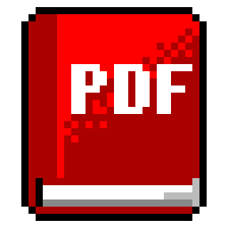

# EPDF



A PDF viewer for the Atari ST, STE, TT and Falcon, written in C for GEM: the text of a document on
every machine, and, from a later stage, its pages as they were made on the TT and the Falcon.

*Work in progress: stage 1, the text view, is being built. There is no release yet.*

**Highlights**

- **Every page's text on any Atari, down to a 1 MB ST:** the paragraphs joined and wrapped to the
  window, or each line as it is on the page, with the pictures where they stand. The text is read in the background, a page at a
  time, while you read; a long document's text goes to a cache file when memory is short.
- **Fast on the stock machines:** a scroll moves what stays on the screen and draws only what comes
  in; nothing waits for the reading.
- **Modern but Atari:** iconify, drag and drop, the desktop's AV protocol, help in EHypView or
  ST-Guide, the AERA family's look and keys.
- **Encrypted PDFs** with an empty user password: RC4 and AES, up to AES-256.

## Getting started

There is no release yet. The first, 0.1, will be made by the Release workflow from `main`; its zip
will hold:

| File | What it is |
|---|---|
| `EPDF.PRG` | the program, for every ST, STE, TT and Falcon |
| `EPDF.HYP`, `EPDF.REF` | the guide, for EHypView or ST-Guide |
| `NOTICES.TXT` | the licences of the parts EPDF is made with |
| `icons/EPDF.RSC`, `EPDF.ICN`, `EPDFMK.ICN` | the program's desktop icon |
| `icons/EPDFDOC.RSC` | the icon for PDF files on the desktop |
| `icons/EPDFNV.RSC`, `EPDFDNV.RSC` | the same two for NVDI without TOS's palette loaded |

1. Copy `EPDF.PRG` into a folder of its own, such as `C:\EPDF\`. It keeps `EPDF.INF` (its settings),
   `EPDF.TXC` (the text of the document open, while it is) and any `CRASH.LOG` beside itself.
2. Copy `EPDF.HYP` and `EPDF.REF` into `C:\GUIDES\`, or beside `EPDF.PRG`. **Help** in EPDF opens
   them in EHypView or ST-Guide.
3. **To open a PDF with a double-click**, install `EPDF.PRG` on the desktop as the application for
   `PDF` files: on TOS 2, 3 and 4 with **Options > Install application...**; in Thing and Teradesk
   in their own settings for applications.
4. **The icons:** take `EPDF.RSC` and `EPDFDOC.RSC` under TOS, EmuTOS, MagiC, or NVDI with TOS's
   palette loaded (COLORVDI.CPX); `EPDFNV.RSC` and `EPDFDNV.RSC` under NVDI with its own palette.
   `EPDFDOC` is the icon for `*.PDF` in the desktop's **Install icon...**.

**Needs:** any ST, STE, TT or Falcon with 1 MB or more; TOS 1.04 or newer, EmuTOS, MagiC or MiNT; a
screen 640 pixels wide or more. EPDF takes about 420 KB when it starts, and more as it reads (the
pages' text up to a quarter of what is free, the rest in `EPDF.TXC`; a picture's own buffers while
it is decoded): on a 1 MB ST, run it without the family's accessories.

**Under TOS, put Atari's `FOLDR100.PRG` first in `AUTO`**, renamed for more room (`FOLDR400.PRG`).
TOS keeps an entry in a small internal pool for every folder a program or accessory has looked
into, and halts with "OUT OF INTERNAL MEMORY" when it runs out; FOLDRxxx makes the pool bigger.

## How it reaches the servers

It doesn't: EPDF works on files, and needs no network.

## Building

```sh
sudo apt install gcc-m68k-linux-gnu python3   # Debian/Ubuntu; no MiNTLib needed
make            # binary/EPDF.PRG; host tools in build/
make test       # unit tests on this computer
make dist       # dist/EPDF-x.y.zip, as on the Releases page
make help HCP=/path/to/hcp   # EPDF.HYP from docs/GUIDE.md (hcp: common/tools/build-hcp.sh)
make icons      # icons/ and src/gem/icon*.h from common/icons/EPDF.txt, EPDFDOC.txt
```

`binary/` and `dist/` are what make builds; they are never committed, and a build changes no tracked
file. A release: `tools/bump.py`, commit and push, then **Actions > Release > Run workflow** on `main`
with what is new. The workflow tests, builds, tags the commit `vX.Y` and publishes the files and the
zip on the Releases page. Builds in between are never handed out: to try a change, release it.

The measurement run that chose EPDF's design (stage 0) is in [docs/MEASUREMENT.md](docs/MEASUREMENT.md):
`make measure` on this computer, `make measure-atari` and `tests/hatari/measure.py` in Hatari.

## Source

```
src/        the PDF reader (portable C, also built for this computer in the tests)
src/view/   the text view's model: layout, the pages' text store, settings (host-tested)
src/gem/    GEM: the window, the menu, the About box
atari/      the stage 0 measuring programs and LAUNCH.PRG for the rigs
tests/      host unit tests and the Hatari rigs (tests/hatari)
tools/      the corpus fetch, the measurement run, the help file, the release bump
docs/       the user guide (GUIDE.md, the source of EPDF.HYP), the measurement report, pictures
icons/      the desktop icons (made by make icons)
third_party/ FreeType (pinned, with its licence)
common/     the shared AERA library (from AERA-Atari; never changed here)
```

## Tests

`make test` runs the host unit tests (the text layout, the page store, the document view, the
settings file, the CCITT decoder) and checks the Atari programs: no FPU instruction in a 68030
build, no word or long at an odd stack offset in the 68000 one.

The Hatari rigs start the family's machines (`ST`, `ST-1`, `TT`, `Falcon`, `Falcon-4`) through
`common/tools/machines.py`:

- `make gui-test` (`tests/hatari/gui.py`): EPDF opened on a document, scrolled, paged;
- `make speed-test` (`tests/hatari/speed.py`): each action's longest stretch between event calls on
  `ST` and `Falcon-4`, against the guidelines' times.

## Licence

EPDF is free software: you can redistribute it and/or modify it under
the terms of the GNU General Public License as published by the Free
Software Foundation, either version 2 of the License, or (at your option)
any later version. It is distributed in the hope that it will be useful,
but WITHOUT ANY WARRANTY; without even the implied warranty of
MERCHANTABILITY or FITNESS FOR A PARTICULAR PURPOSE. See [COPYING](COPYING).

Copyright (C) 2026 AERA | Erez Yaary.

It includes, under their own licences (compatible with the GPL), as `NOTICES.TXT` lists:

- [BearSSL](common/third_party/bearssl) by Thomas Pornin (MD5, SHA-2, AES for encrypted PDFs): MIT
  licence
- [TJpgDec](common/third_party/tjpgd) by ChaN (JPEG pictures): its own free licence
- [libnsgif](common/third_party/nsgif) from NetSurf (GIF, in the family's picture code): MIT licence
- [FreeType](third_party/freetype), the FreeType Project Licence or the GPL version 2 (used by the
  stage 0 measuring programs; the pages' drawing will use it)

---

Part of **AERA** for Atari: [ECal](https://github.com/whomper/ECal) · [EContact](https://github.com/whomper/EContact) · [EMail](https://github.com/whomper/EMail) · [EFTP](https://github.com/whomper/EFTP) · [EHypView](https://github.com/whomper/EHypView) · [ClaudeST](https://github.com/whomper/ClaudeST) · [EWeb](https://github.com/whomper/EWeb) · [EUpdate](https://github.com/whomper/EUpdate) · [EPDF](https://github.com/whomper/EPDF) · 8-bit: [EDOS](https://github.com/whomper/EDOS) · [EFTP_XL](https://github.com/whomper/EFTP_XL) · Pi: [AERA-Gateway](https://github.com/whomper/AERA-Gateway)
