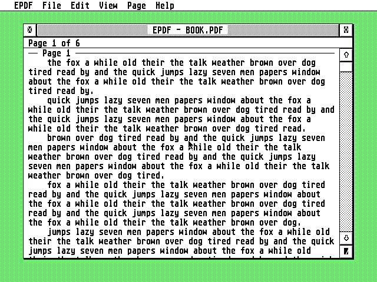

# EPDF


ONE SENTENCE: what it is, for which Ataris. *(e.g. "A calendar for the Atari ST, STE, TT and Falcon,
written in C for GEM.")*

**Highlights**

- **THE MAIN THING:** one line on what it does best.
- **Modern but Atari:** desk accessory and program, right-click menus, drag and drop, iconify, help in
  EHypView/ST-Guide (keep what is true).
- **Secure:** TLS 1.2 on the Falcon and TT; ST and STE through a Raspberry Pi gateway (networked apps
  only).
- **Hebrew**, in the Atari character set (when supported).



## Getting started

Download the latest `EPDF-x.y.zip` from **[Releases](../../releases/latest)** and unpack it. It contains:

| File | What it is |
|---|---|
| `EPDF.PRG` / `EPDF.ACC` | the program, for every ST, STE, TT and Falcon |
| `TLS.OVL` | the Direct connection (TLS on a TT or Falcon, RSA on the DSP), loaded only when used; an ST leaves it on the disk |
| `EPDF.HYP`, `EPDF.REF` | the help, for EHypView or ST-Guide |
| `CACERT.PEM`, `ROOTS.DAT` | root certificates for a Direct connection |

1. Copy `EPDF.ACC` to the root of your boot drive (or start `EPDF.PRG` from anywhere).
2. ...
3. Press **Help** in EPDF for the guide.

**Needs:** TOS 1.04 or newer, MagiC, N.AES or XaAES; 640×200 or larger; RAM; network: STinG or MiNTnet.

**Under TOS, put Atari's `FOLDR100.PRG` first in `AUTO`**, renamed for more room (`FOLDR400.PRG`).
TOS keeps an entry in a small internal pool for every folder a program or accessory has looked
into, and halts with "OUT OF INTERNAL MEMORY" when it runs out; FOLDRxxx makes the pool bigger.

*(Networked apps.)* **With STinG, set the Delay in `STING.CPX` to suit the machine:** 10 on a
Falcon or TT, 25 to 50 on an ST, as STinG's manual says. STinG looks at the network card that
often, so it sets the speed of every STinG program: on Erez's Falcon with a NetUSBee, Delay 10
took EFTP's downloads from 40 to 75 KB/s. On a NetUSBee, keep STinG's TCP receive window at 5840
(MSS 1460): the card holds about four full packets.

## How it reaches the servers

*(Networked apps only.)* Which machine connects how, with the same diagram style as ECal:

```
ST, STE:     Atari (EPDF) --plain, home LAN--> Raspberry Pi (gateway) --TLS--> the server
Falcon, TT:  Atari (EPDF + TLS.OVL: TLS 1.2, RSA on the DSP) ------------TLS--> the server
             (a Direct connection; or through the Pi, as an ST)
```

The gateway's own README: [`gateway/`](gateway/).

## Building

```sh
sudo apt install gcc-m68k-linux-gnu python3   # Debian/Ubuntu; no MiNTLib needed
make            # binary/EPDF.PRG, EPDF.ACC, TLS.OVL (common's, as it is)
make test       # unit tests on this computer, plus the gateway's tests
make itest      # against a local server (SERVER-NAME)
make dist       # dist/EPDF-x.y.zip, as on the Releases page
make help HCP=/path/to/hcp   # EPDF.HYP from docs/GUIDE.md (hcp: github.com/th-otto/hypview)
```

`binary/` and `dist/` are what make builds; they are never committed, and a build changes no tracked
file. A release: `tools/bump.py`, commit and push, then **Actions > Release > Run workflow** on `main`
with what is new. The workflow tests, builds, tags the commit `vX.Y` and publishes the
files and the zip on the Releases page. Builds in between are never handed out: to try a change, release it.

## Source

```
src/        the program's core, also built for this computer in the tests
ui/         GEM: windows, dialogs, menus
atari/      the Atari runtime (from the shared AERA library)
gateway/    the Raspberry Pi gateway (networked apps)
tests/      host unit tests (tests/host) and Hatari rigs (tests/hatari)
tools/      build helpers: TOS header, icons, help file, version bump
docs/       the user guide (GUIDE.md, the source of EPDF.HYP) and pictures
```

## Tests

What `make test` covers. How to run the Hatari rigs, and which emulated machines they use.

## Licence

EPDF is free software: you can redistribute it and/or modify it under
the terms of the GNU General Public License as published by the Free
Software Foundation, either version 2 of the License, or (at your option)
any later version. It is distributed in the hope that it will be useful,
but WITHOUT ANY WARRANTY; without even the implied warranty of
MERCHANTABILITY or FITNESS FOR A PARTICULAR PURPOSE. See [COPYING](COPYING).

Copyright (C) 2026 AERA | Erez Yaary.

It includes, under their own licences (compatible with the GPL):

- [BearSSL](third_party/bearssl) by Thomas Pornin: MIT licence
  ([LICENSE.txt](third_party/bearssl/LICENSE.txt))
- `CACERT.PEM`, the root certificates for a Direct connection, from Mozilla's CA
  list (Mozilla Public License 2.0)

---

Part of **AERA** for Atari: [ECal](https://github.com/whomper/ECal) · [EContact](https://github.com/whomper/EContact) · [EMail](https://github.com/whomper/EMail) · [EFTP](https://github.com/whomper/EFTP) · [EHypView](https://github.com/whomper/EHypView) · [ClaudeST](https://github.com/whomper/ClaudeST) · [EWeb](https://github.com/whomper/EWeb) · [EUpdate](https://github.com/whomper/EUpdate) · 8-bit: [EDOS](https://github.com/whomper/EDOS) · [EFTP_XL](https://github.com/whomper/EFTP_XL) · Pi: [AERA-Gateway](https://github.com/whomper/AERA-Gateway)
