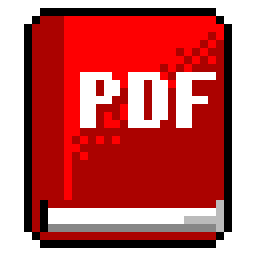
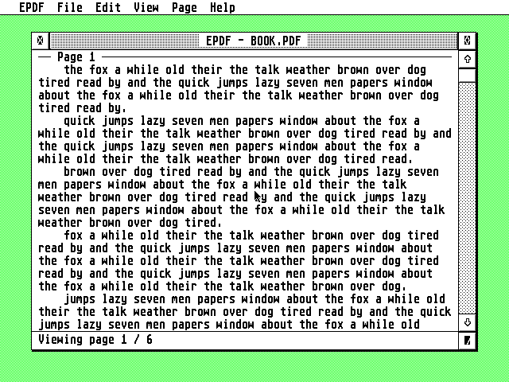
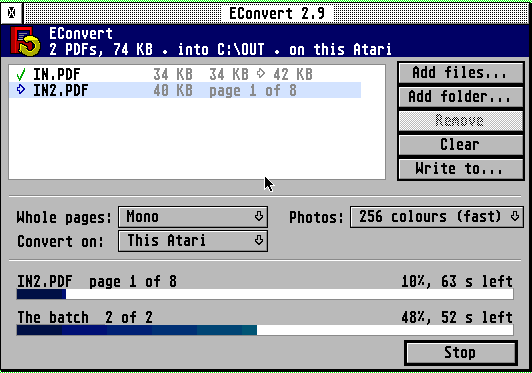

# EPDF



A PDF viewer for the Atari ST, STE, TT and Falcon, written in C for GEM: the text of a document on
every machine, and its pages as they were made on the TT and the Falcon. EConvert, which comes with
it, prepares PDFs so that EPDF opens them fast, on the Atari itself or through the Gateway.





**Highlights**

- **Every page's text on any Atari, down to a 1 MB ST:** the paragraphs joined and wrapped to the
  window, or each line as it is on the page, with the pictures where they stand. The text is read in the background, a page at a
  time, while you read; a long document's text goes to a cache file when memory is short.
- **Fast on the stock machines:** a scroll moves what stays on the screen and draws only what comes
  in; nothing waits for the reading.
- **Modern but Atari:** iconify, drag and drop, the desktop's AV protocol, help in EHypView or
  ST-Guide, the AERA family's look and keys.
- **The pages as printed on a TT or Falcon:** View > Pages draws each page with its fonts, pictures
  and drawings, in the screen's colours (16 or 256), from the top down. Zoom with ^+ and ^- (or the
  keypad's + and -) from 150 to 400 % as memory allows, and drag the page with the mouse; a band on
  the page says while a sharper one is being drawn. JPEG pictures go through the Falcon's DSP.
- **EConvert:** many PDFs or a whole folder made ready for the Atari, on a Falcon or TT or through
  the Gateway: the text reflowed already, the pictures at the size the screen shows them, and each
  page whole in mono, colour or both. EPDF opens such a file at once on any Atari and marks its
  pages **Optimised**.
- **The Gateway** (AERA-Gateway on a Raspberry Pi): with Options > Open on the Gateway, a PDF is
  converted there while you read it; File > Save Optimised... keeps the converted copy.
- **Translate:** View > Translate shows the text in another language, through the Gateway's
  translation service.
- **Hebrew** and other right-to-left text, find, select and copy to the clipboard.
- **Encrypted PDFs** with an empty user password: RC4 and AES, up to AES-256.

## Getting started

Take the latest release from the [Releases page](https://github.com/whomper/EPDF/releases). Its zip
holds:

| File | What it is |
|---|---|
| `EPDF.PRG` | the program, for every ST, STE, TT and Falcon |
| `RENDER.OVL` | the pages' drawing on a TT or Falcon (View > Pages, zoom), loaded only on a 68020 or better |
| `EPDF.HYP`, `EPDF.REF` | the guide, for EHypView or ST-Guide |
| `NOTICES.TXT` | the licences of the parts EPDF is made with |
| `icons/EPDF.RSC`, `EPDF.ICN`, `EPDFMK.ICN` | the program's desktop icon |
| `icons/EPDFDOC.RSC` | the icon for PDF files on the desktop |
| `icons/EPDFNV.RSC`, `EPDFDNV.RSC` | the same two for NVDI without TOS's palette loaded |
| `icons/ECONVERT.RSC`, `ECONVERT.ICN`, `ECONVMK.ICN` | EConvert's desktop icon (`ECONVNV.RSC` for NVDI with its own palette) |
| `econvert/` | EConvert, which prepares PDFs for EPDF on a Falcon or a TT: `ECONVERT.PRG` and the fonts it draws with (`fonts/`) |

1. Copy `EPDF.PRG` into a folder of its own, such as `C:\EPDF\`. It keeps `EPDF.INF` (its settings),
   `EPDF.TXC` (the text of the document open, while it is) and any `CRASH.LOG` beside itself.
2. On a TT or Falcon, put `RENDER.OVL` beside `EPDF.PRG`, and the fonts from `econvert/fonts`
   in a `FONTS` folder beside it (or leave EConvert's in `ECONVERT\FONTS`): they draw the pages.
3. Copy `EPDF.HYP` and `EPDF.REF` into `C:\GUIDES\`, or beside `EPDF.PRG`. **Help** in EPDF opens
   them in EHypView or ST-Guide.
4. **To open a PDF with a double-click**, install `EPDF.PRG` on the desktop as the application for
   `PDF` files: on TOS 2, 3 and 4 with **Options > Install application...**; in Thing and Teradesk
   in their own settings for applications.
5. **The icons:** take `EPDF.RSC` and `EPDFDOC.RSC` under TOS, EmuTOS, MagiC, or NVDI with TOS's
   palette loaded (COLORVDI.CPX); `EPDFNV.RSC` and `EPDFDNV.RSC` under NVDI with its own palette.
   `EPDFDOC` is the icon for `*.PDF` in the desktop's **Install icon...**.

**Needs:** any ST, STE, TT or Falcon with 1 MB or more; TOS 1.04 or newer, EmuTOS, MagiC or MiNT, with
or without NVDI; a screen 640 pixels wide or more. The pages as printed and EConvert need a 68030
(TT or Falcon); on a stock 4 MB Falcon the zoom stops at 150 %. EPDF takes about 390 KB when it starts, and more as it reads (the
pages' text up to a quarter of what is free, the rest in `EPDF.TXC`; a picture's own buffers while
it is decoded): on a 1 MB ST, run it without the family's accessories.

**Under TOS, put Atari's `FOLDR100.PRG` first in `AUTO`**, renamed for more room (`FOLDR400.PRG`).
TOS keeps an entry in a small internal pool for every folder a program or accessory has looked
into, and halts with "OUT OF INTERNAL MEMORY" when it runs out; FOLDRxxx makes the pool bigger.

## How it reaches the servers

EPDF and EConvert work on files. Only in Gateway mode do they use the network: a PDF goes to the
Gateway (AERA-Gateway's `pdf` service, port 8380, on a Raspberry Pi at home) through STinG,
MiNTnet or MagiC-Net, and the converted PDF comes back (`docs/PI-GATEWAY.md`). View > Translate
uses the Gateway's translation service the same way. Set the Gateway's address and port in
**Options > Settings...**; nothing is sent while Gateway mode and Translate are off. EPDF talks to
the Gateway in plain HTTP on the home network; it has no TLS of its own.

## Building

```sh
sudo apt install gcc-m68k-linux-gnu python3   # Debian/Ubuntu; no MiNTLib needed
make            # binary/EPDF.PRG; host tools in build/
make test       # unit tests on this computer
make dist       # dist/EPDF-x.y.zip, as on the Releases page
make help HCP=/path/to/hcp   # EPDF.HYP from docs/GUIDE.md (hcp: common/tools/build-hcp.sh)
make icons      # icons/, src/gem/icon*.h and src/econv/icon*.h from common/icons/EPDF.txt, EPDFDOC.txt
```

`binary/` and `dist/` are what make builds; they are never committed, and a build changes no tracked
file. A release: `tools/bump.py`, commit and push, then **Actions > Release > Run workflow** on `main`
with what is new. The workflow tests, builds, tags the commit `vX.Y` and publishes the files and the
zip on the Releases page. Builds in between are never handed out: to try a change, release it.

The measurement run that chose EPDF's design (stage 0) is in [docs/MEASUREMENT.md](docs/MEASUREMENT.md):
`make measure` on this computer, `make measure-atari` and `tests/hatari/measure.py` in Hatari.

## Source

```
src/        the PDF reader (portable C, also built for this computer in the tests)
src/view/   the text view's model: layout, the pages' text store, settings (host-tested)
src/gem/    GEM: the window, the menu, the dialogs, the pictures, the Gateway
src/conv/   the converter (EConvert's and the Gateway's): reflow, pictures, pages whole
src/econv/  EConvert's window
src/rovl/   RENDER.OVL, the pages' drawing on a 68030
gateway/    a read-only copy of AERA-Gateway's services, for the tests
atari/      the stage 0 measuring programs and LAUNCH.PRG for the rigs
tests/      host unit tests and the Hatari rigs (tests/hatari)
tools/      the corpus fetch, the measurement run, the help file, the release bump
docs/       the user guide (GUIDE.md, the source of EPDF.HYP), the measurement report, pictures
icons/      the desktop icons (made by make icons)
third_party/ FreeType and the Liberation fonts (pinned, with their licences)
common/     the shared AERA library (from AERA-Atari; never changed here)
```

## Tests

`make test` runs the host unit tests (the text layout, the page store, the document view, the
settings file, the CCITT decoder) and checks the Atari programs: no FPU instruction in a 68030
build, no word or long at an odd stack offset in the 68000 one.

The Hatari rigs start the family's machines (`ST`, `ST-1`, `TT`, `Falcon`, `Falcon-4`) through
`common/tools/machines.py`:

- `make gui-test` (`tests/hatari/gui.py`): EPDF opened on a document, scrolled, paged;
- `make speed-test` (`tests/hatari/speed.py`): each action's longest stretch between event calls on
  `ST` and `Falcon-4`, against the guidelines' times;
- `make files-test` (`tests/hatari/files.py`): each file's opens on a 1 MB ST, from Hatari's GEMDOS
  trace, while a 40-page book is read, paged through and closed: the PDF opened once, `EPDF.TXC` made
  and opened once;
- `tests/hatari/zoom.py`, `prepared.py`, `econv.py`, `econv_speed.py`, `gateway.py` (against the
  Gateway's own `pdfgate.py`) and `translate_view.py`: the pages, converted PDFs, EConvert, the
  Gateway and translation.

The Falcon of these rigs is Erez's configuration where the machine has the files: a 4 MB Falcon with
TOS 4.04 and NVDI in 256 colours (`tests/hatari/erz.py`); else the same machine on EmuTOS.

## Licence

EPDF is free software: you can redistribute it and/or modify it under
the terms of the GNU General Public License as published by the Free
Software Foundation, either version 2 of the License, or (at your option)
any later version. It is distributed in the hope that it will be useful,
but WITHOUT ANY WARRANTY; without even the implied warranty of
MERCHANTABILITY or FITNESS FOR A PARTICULAR PURPOSE. See [COPYING](COPYING).

Copyright (C) 2026 AERA | Erez Yaary.

It includes, under their own licences (compatible with the GPL), as `NOTICES.TXT` lists:

- [BearSSL](common/third_party/bearssl) by Thomas Pornin (MD5, SHA-2, AES for encrypted PDFs): MIT
  licence
- [TJpgDec](common/third_party/tjpgd) by ChaN (JPEG pictures): its own free licence
- [libnsgif](common/third_party/nsgif) from NetSurf (GIF, in the family's picture code): MIT licence
- [FreeType](third_party/freetype), the FreeType Project Licence or the GPL version 2 (the pages'
  drawing and EConvert)
- [Liberation fonts](third_party/liberation) 2.1.5, the SIL Open Font Licence 1.1 (the standard
  fonts EConvert and the pages' drawing use)

---

Part of **AERA** for Atari: [ECal](https://github.com/whomper/ECal) · [EContact](https://github.com/whomper/EContact) · [EMail](https://github.com/whomper/EMail) · [EFTP](https://github.com/whomper/EFTP) · [EHypView](https://github.com/whomper/EHypView) · [ClaudeST](https://github.com/whomper/ClaudeST) · [EWeb](https://github.com/whomper/EWeb) · [EUpdate](https://github.com/whomper/EUpdate) · [EPDF](https://github.com/whomper/EPDF) · 8-bit: [EDOS](https://github.com/whomper/EDOS) · [EFTP_XL](https://github.com/whomper/EFTP_XL) · Pi: [AERA-Gateway](https://github.com/whomper/AERA-Gateway)
